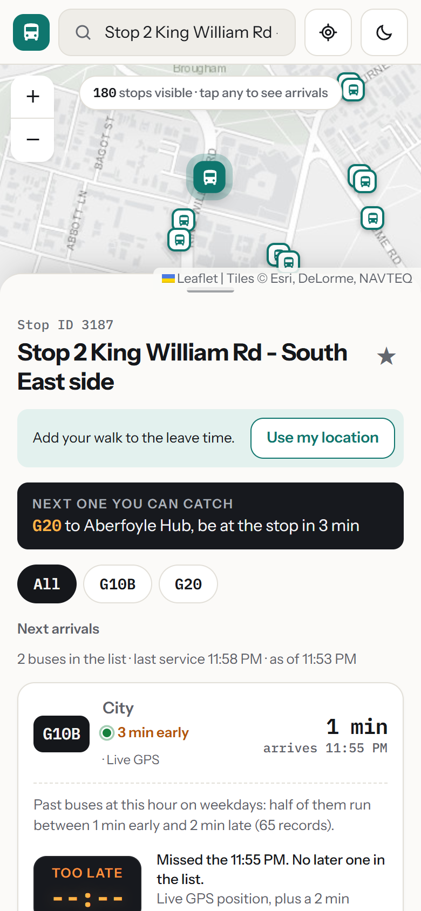
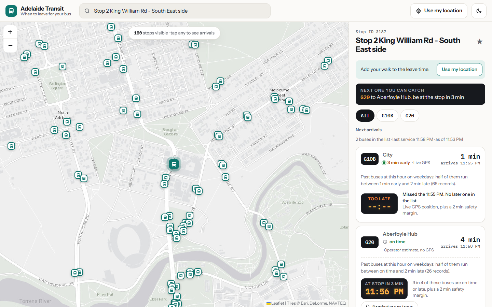

# Adelaide Transit Predictor

Live bus and tram arrivals for Adelaide Metro, with **historical delay patterns** baked in so users know when to actually leave home.

Live: https://adelaide-transit-predictor.vercel.app

<p>
  
</p>



Built as a solo learning project. Stack: FastAPI + SQLite + Leaflet, no frameworks on the frontend.

## The problem this solves

Most transit apps show the schedule, or a live prediction if GPS is available. They fail when:

- A bus has no live GPS (common for some buses and most trams): they fall back to the timetable, which is often wrong
- The user doesn't know the route's typical behavior: "this bus is usually 4 min early at 8 AM" is invisible

This app collects realtime delay data 24/7, then uses that history to fill in the gaps for scheduled-only services. The "Be at stop by" recommendation is the headline output.

## What it does

- **Live arrivals**: pulled from the GTFS-Realtime feed every 30 seconds
- **Per-route, per-hour delay patterns**: learned from collected history (interquartile range, not naive average)
- **"Leave by" board**: combines live data, history and your walking time into one time that counts down to Leave now, and says Too late with the next option when you will miss it
- **Next one you can catch**: arrivals grouped by route, with route chips and a saved "my route" per favourite stop
- **Honest data source labels**: "Live GPS", "Operator estimate, no GPS" or "Timetable only", so users aren't misled
- **Per-route reliability**: see how each route behaves at this stop, broken down by morning/midday/evening/night
- **Trip planner API**: direct trips from A to B with typical delay annotation (no screen for it yet)
- **Favourite stops**: saved in browser localStorage
- **Public holidays and late nights**: holiday timetables from calendar_dates, and trips after midnight from the previous service day
- **Mobile-responsive**: works on iPhone

## Tech

| Layer | Choice | Why |
|---|---|---|
| Backend | FastAPI (Python) | Async, auto-docs, lightweight |
| Database | SQLite (WAL mode) | Single file, multi-process safe, handles 100M+ rows |
| Static feed | GTFS .zip from Adelaide Metro | Industry standard, free, no API key |
| Realtime feed | GTFS-Realtime protobuf | Same standard, refreshed every 30s |
| Frontend | Vanilla HTML/JS + Leaflet + Chart.js | No build step, instant loading |
| Map tiles | Esri Light Gray Canvas | Free, no API key, quiet enough for stop markers |
| Hosting | Vercel (frontend), Oracle Cloud VM with systemd (API, collector, weekly timetable reload) | Free tier, runs 24/7 |

## Data sources

All free and public. No API keys.

- GTFS Static: `https://gtfs.adelaidemetro.com.au/v1/static/latest/google_transit.zip`
- GTFS-RT Trip Updates: `https://gtfs.adelaidemetro.com.au/v1/realtime/trip_updates`
- GTFS-RT Vehicle Positions: `https://gtfs.adelaidemetro.com.au/v1/realtime/vehicle_positions`

## Quick start (Windows)

```powershell
cd backend
.\scripts\setup.ps1          # one-time: venv + deps + GTFS download
.\scripts\run_api.ps1        # terminal 1: API on :8000
.\scripts\run_collector.ps1  # terminal 2: realtime poller
```

Then:

```powershell
cd ..\frontend
.\serve.ps1                  # static UI on :5173
```

Open <http://localhost:5173>.

## API endpoints

- `GET /stops?lat=&lon=&radius_km=`: stops near a point
- `GET /stops?q=name`: search by name
- `GET /stop/{stop_id}/next`: next arrivals with typical-delay annotations
- `GET /stop/{stop_id}/reliability`: per-hour + per-route breakdown
- `GET /route/{route_id}/reliability`: delay by hour for this route
- `GET /trip/plan?from=&to=&arrive_by=HH:MM`: direct trips A → B
- `GET /routes`, `GET /stats`

Auto-generated docs at `/docs`.

## How the prediction works

1. Collector polls trip updates + vehicle positions every 30 seconds.
2. Each stop-time update gets stored with `has_gps = 1` if the trip has a vehicle position, else `0`.
3. For each arrival query, the app looks up history filtered to:
   - exact hour + same day-type (weekday/weekend): preferred
   - ±1 hour + same day-type: fallback
   - any hour + same day-type: fallback
   - any data: last resort
4. The chosen bucket returns P25 / P50 / P75 of delay (interquartile, robust to outliers).
5. Frontend categorises into `on_time / late / early / mixed` and produces wording + a "leave by" time.

Only `has_gps = 1` rows are used for the pattern, schedule-echo rows (no real GPS) are ignored so patterns reflect actual bus behavior, not the timetable.

## Project status

- **Data collected so far**: only a few days (started May 2026). Patterns will be sparse until ~1 week.
- **Live arrivals**: work immediately, no warm-up needed.
- **Reliability charts**: fill in as data accumulates.
- **Hosting**: frontend on Vercel, API and collector on a small Oracle Cloud VM. Server notes are in [backend/deploy/README.md](backend/deploy/README.md).
- **Tests**: `cd backend && python -m unittest` (API tests on a throwaway database), run by GitHub Actions on every push.

## Deploy

For a public iPhone-accessible version:

- Frontend → Vercel (drag the `frontend/` folder)
- Backend → expose local API via Cloudflare Tunnel:
  ```
  cloudflared tunnel --url http://localhost:8000
  ```
- Update `const API = "..."` in `frontend/index.html` to the tunnel URL.

For 24/7 production, migrate SQLite → Postgres and move the collector to a free-tier VM (Oracle Cloud, Fly.io).

## Roadmap

- [x] Phase 1: live tracker
- [x] Phase 2: reliability charts per stop/route
- [x] Phase 3: typical-delay annotations on arrivals
- [x] Phase 4: has_gps flag + honest "Scheduled" labels
- [ ] Phase 5: LightGBM model for sub-minute delay prediction
- [ ] Phase 6: push alerts ("your usual 8:15 bus is 8 min late, leave now")
- [ ] Phase 7: multi-leg trip planning (transfers)
- [ ] Phase 8: weather as a feature

## License

MIT, see [LICENSE](LICENSE). Timetable and realtime data: Adelaide Metro open data. Map tiles: Esri.

## Acknowledgments

Adelaide Metro for publishing open GTFS feeds. ENGR3791 at Flinders University for the kick that started this.
